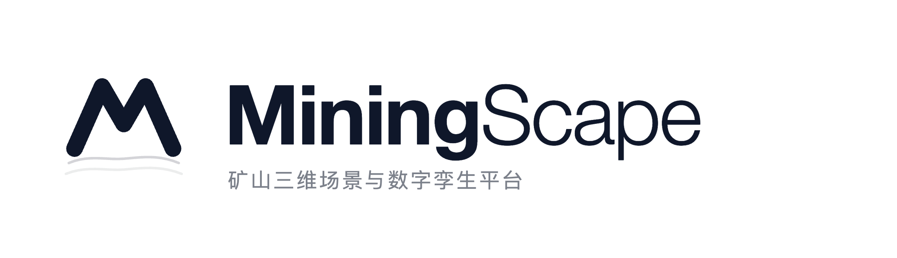

<div align="center">
  <picture>
    <source media="(prefers-color-scheme: dark)" srcset="https://raw.githubusercontent.com/MiningScape/.github/main/profile/assets/logo-dark.png">
    
  </picture>

  <p><strong>矿山三维场景与数字孪生平台</strong><br>
  <sub>Build, twin and operate your mine in 3D.</sub></p>
</div>

---

MiningScape（矿境）把矿山 CAD、测量与业务数据组织成可运行的三维场景：从 DWG/DXF 解析、坐标配准、地形与地质建模，到 3D Tiles 发布、CesiumJS 可视化，以及人员、设备、机械的实时数字孪生。

## 我们在构建什么

| 项目 | 说明 |
|---|---|
| **Open Mining Skills** | 17 个开源 Agent Skills，覆盖数据巡检、CAD 解析、坐标配准、地形 / 点云 / 地质建模、3D Tiles、Cesium、质量检查与数字孪生业务。 → [MiningScape/open-mining-skills](https://github.com/MiningScape/open-mining-skills) |
| **MiningScape Platform** | 平台主仓库（规划中）：Spring Boot + Vue 3 + CesiumJS + Python 处理服务，统一场景、模型、实时数据与权限。 |

## 数据链路

```text
DWG/DXF · XYZ · 点云
        ↓
数据巡检 → CAD 解析 → 坐标配准 → 地形 / 地质建模
        ↓
3D Tiles → CesiumJS 三维场景 → 人员 / 设备 / 机械数字孪生
```

## 技术栈

`Spring Boot` · `Vue 3` · `CesiumJS` · `3D Tiles` · `PostgreSQL / PostGIS` · `Python` · `ThingLinks`

## 仓库

| 仓库 | 内容 | 状态 |
|---|---|---|
| [open-mining-skills](https://github.com/MiningScape/open-mining-skills) | 17 个矿山三维与数字孪生 Agent Skills | v0.1 |
| `platform` | 平台主仓库（规划中） | Planned |
| `viewer` | 可复用 Cesium 组件库（规划中） | Planned |

## 参与

- 技能库的问题与建议：[Issues](https://github.com/MiningScape/open-mining-skills/issues)
- 欢迎提交 PR、补充矿山数据格式、算法与行业规则。

<sub>© 2026 MiningScape · 矿境 · Open skills are MIT licensed.</sub>
